# 精读 Zoom In：An Introduction to Circuits

## 阅读须知

本文以中文译版作为母版，而非基于英文原版的理解，故可能存在一定的名词误译；文章不再过多粘贴原文，而是以批注与思考为主。

万字长文整理不易，转载引用请注明出处 。

- 原文地址：[英文原文](https://distill.pub/2020/circuits/zoom-in/)
- 自制中文译版（豆包）：[GitHub 中文译版下载直链](https://github.com/missmissrain/paper-zh-translation/raw/main/Zoom%20In%20%E4%B8%AD%E6%96%87%E5%85%A8%E6%96%87%E7%BF%BB%E8%AF%91.docx)

## 论文介绍

Zoom In: An Introduction to Circuits，中文译名为：放大镜：详解计算电路。

这篇文章是 Chris Olah 于 2020 年 3 月 10 日发表在 Distill 上的一篇综述性论文，也是神经网络可解释性的奠基性综述论文。

深度学习在很长一段时间里都被认为是不可解释系统：我们仅定义输入、结构与输出，却无法真正地观测到系统计算能力的形成过程。

这一局限性是十分致命的。其一，我们不知道系统在什么情况下会作出什么样的反应，就无法彻底地信任它；其二，若我们可知计算能力的形成过程，便有机会反向干涉这一过程，让其向我们期望的方向发展，也可加速模型的收敛，减少模型为了保证性能而增加的冗余结构。

Chris 的核心出发点是尝试把神经网络内部的计算过程拆开看，通过对神经元的功能性分析，基于其团队提出的一些观测方法，来论证他们有关性能形成机制的主张。

## 引言

自古以来，科学史上许多重要的转折点，都发生在可观测尺度被 "zooming in（放大）" 的时刻：人们往往会发明一种新的可视化方法或工具，使得我们能够在更精细的层面上观察世界；而在这基础上，往往会衍生出一门新的科学。

比如显微镜让我们看见了细胞，X 射线晶体学等技术让我们看见了 DNA；原子、电子等更小的单元，也随着观测技术的进步被人类逐一发现。

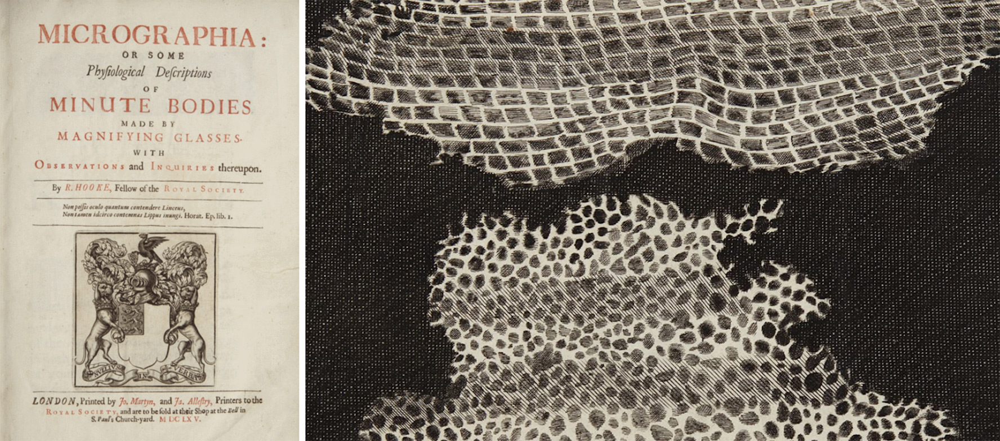

*图 1（原文插图）：胡克（Hooke）的《显微图谱》（Micrographia）。该书透过显微镜展现了一个丰富的微观世界，包括对细胞的初步发现。（图像来自威尔士国家图书馆）*

作者从基础科学哲学角度出发，试图深入神经网络的较小尺度中，来解释神经网络的宏观现象。作者指出，在此之前的大多数可解释性研究，聚焦于对神经网络整体的行为给出一个简洁的解释，而不是深入内部、对神经元的应激状态进行细致的跟踪。

*图（原文插图）：DeepDream 图像，暗示现代神经网络内部丰富的内在特征世界。*

在深入研究以后，作者发现：神经元不仅看起来是可以理解的，而且它们之间的连结似乎构成了某种计算路径，对应着真实世界的种种事实；甚至有一些神经元负责的是更抽象的逻辑计算，比如与、或、异或这样的计算逻辑。

## 三大主张

什么是主张？在论文的语境下，"主张"这个词可以理解为作者的一种尚未被充分证明、但已有一定证据支撑的观点或立场。论文一共提出了三大主张，正文主要便是阐述这三大主张及其证据。

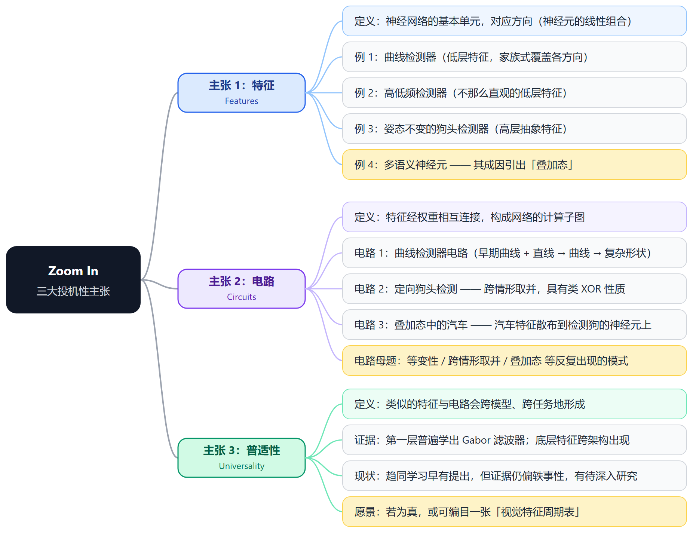

*图：本文三大主张及其支撑例证总览（博主自绘）。*

*图（原文插图）：施旺《显微镜研究》（Mikroskopische Untersuchungen）。原文正是以施旺在 1839 年提出的细胞学说三大主张为类比，引出本文对神经网络的三大主张。*

### 主张 1：特征 Features

首先是定义，什么是 Features？

原文中的记载为：

> 特征（features）是神经网络的基本单元。它们对应于方向（directions），并且可以被严谨地研究和理解。
>
> **原文脚注**：所谓"方向"，我们指的是某一层神经元的线性组合。你可以把它想成该层神经元激活向量空间中的一个方向向量。通常，讨论单个神经元最有帮助，但我们会看到，在某些情况下，用其他组合来分析网络更有用——尤其是当神经元是"多语义"的时候。（详细定义见术语表。）

作者这里定义的 features 不是某个神经元输出的标量（MLP）或者通道（CNN），也不是一整个中间 vector = Wx。他想说的是：假设当前层有 n 个神经元，那么一个 feature 是至多 n-1 个神经元的输出经过线性组合后的结果。假设某一层 vector 激活后 = [5,4,3,2,1]，那么一个 feature 可能是 0.5×5 + 0.7×1。公式：$f=\sum_{i=1}^{n} c_i e_i$

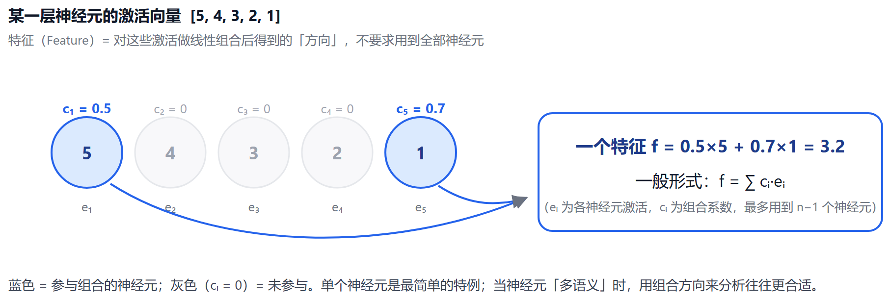

*图：特征即"方向"——同一层神经元激活的线性组合（博主自绘）。*

在这里，作者给出了一个先验——他们认为神经网络是由有意义、可理解的 features 组成的，也就是说整个系统是由 features 不断堆叠所构成的。

不过这仅仅是作者提出的一个很强的假设。文中也指出，哪怕是对 CNN 早期层包含的"边缘检测器""曲线检测器"这类曾被反复发现过的特征层，整个学术社区对这个说法是否成立依然存在分歧。

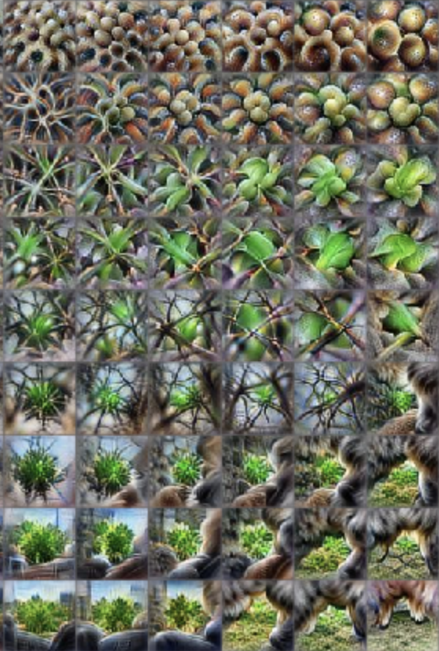

*图（原文插图）：神经网络中不同层次的特征示例——从早期的纹理、曲线，到后期的高层语义概念。*

有的人认为网络确实存在一些可被理解的特征；有的人则认为我们以为的"可被理解的神经元"实际上是一种对权重与数字的误解——他们认为我们以为理解了这些神经元，但实际上这些权重根本不是这样工作的；还有人认为，有意义的特征即使存在，也不如不可解释的特征重要。注意这里的"不如不可解释的特征重要"，博主认为说的是这些特征在神经网络工作时的贡献，不如那些还无法被解释的特征（权重）重要。当然文章的本意到底是什么我也不是很清楚，记载有点模糊。

#### 例 1：曲线检测器 Curve Detectors

作者在这一模块中举了一个关于特征 features 的例子，名为曲线检测器。

作者提到：

> 在我们仔细检查过的每一个非平凡视觉模型中，都能找到检测曲线的神经元。这些单元之所以有趣，是因为它们恰好介于社区普遍认可的特征（如边缘检测器）与争议较大的特征（如耳朵、汽车、面孔等高层特征）之间。

所谓"非平凡视觉模型"，指的是那种并非实验室或者自己搭着玩的玩具模型，而是经过充分训练与结构性验证、可用于工业生产的模型。也就是说，检测曲线的神经元存在于真正工作的模型中是一个普遍现象。后半段说的较大争议的特征，其实指的是：有的人认为部分神经元的组合工作可以被理解，被解读为识别耳朵、汽车、面孔的显著特征；而有的人则认为这些可能是误解，所谓的可解释实际上是牵强附会。

作者在这个模块中的实验主要聚焦于 InceptionV1 的早期层 mixed3b。InceptionV1 是一个经典的 CNN 模型，由 Google 在 2014 年推出，也就是我们说的 GoogLeNet（后续简称 GN），GN 率先提出了在同一层使用混合卷积计算多个通道再 concat 后输出的概念。mixed3b 就是 GN 中的一个混合卷积层，它在网络的前几层出现。

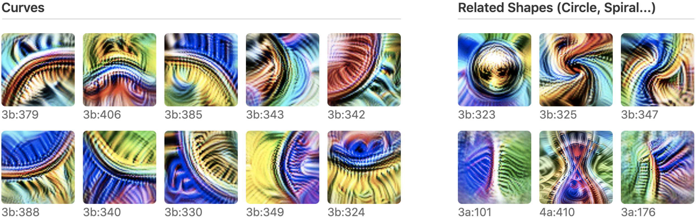

*图 2（原文插图）：左：曲线（Curves）；右：相关形状（圆形、螺旋等）。*

在这个层中，作者发现这些单元（具体是哪些单元没说）会对半径约 60 像素的曲线和边界作出响应，还会被沿曲线边界分布的垂直线略微激发，并且偏好曲线两侧颜色不同。根据作者的描述，这个检测器极有可能是用来检测分水岭或者边界的，尤其是"偏好曲线两侧颜色不同"这个特征很鲜明。

这些曲线检测器（猜测：曲线检测器 = 这一层中 n 个神经元的线性组合）是以单元家族（family）的形式存在的。家族中每个成员检测不同方向的同一种曲线特征。注意，这里博主认为作者所谓的单元家族成员，不仅仅是单个神经元，而是这一层中 n 个神经元的某种线性组合方式；当然这不意味着家庭成员不能是单个神经元，事实上大部分情况下可能仅仅就是单个神经元，也就是单元素子集。家庭成员共同完整地覆盖了所有方向的区间。也就是说，在 mixed3b 这个层中，有 n 种组合方式各异的神经元组会对曲线产生应激，我们称这些神经元组为家族成员，称这 n 个组的集合为 family。假如你将输入的图像进行旋转，那么旋转前激活值最大的神经元组假设是 n，随着你的旋转，激活值最大的神经元组将会变成 m。也就是说，这个 family 里的各个成员主要负责不同方向的应激，而最终它们可以视为一个整体，对任意输入方向的同一曲线响应。这样分治的结构在后续的实验中也被发现，博主认为也许这是一个普遍现象。

为了真正观测到这些神经元，作者提出了七个不同的观测方法。值得注意的是，这七种观测方法不仅仅是用来观测曲线检测器的，而是一套通用的方法，适合用来观测任意神经元。

**方法 1：特征可视化。** 优化输入以让曲线检测器可靠触发，会产生曲线。这建立起一种因果联系，因为结果图像中的一切内容都是为了促使该神经元更强烈地触发而添加进去的。

> **批注 1**：也就是我们不断地去调整输入的图片，以至于让我们所观察的神经元的激活最大化。那么这个能让神经元激活最大化的图片，我们认为就是特征的可视化图。

**方法 2：数据集示例。** 让这些神经元强烈触发的 ImageNet 图像，确实是预期方向的曲线；让它们中等程度触发的图像，通常是不那么完美的曲线或方向略有偏差的曲线。

> **批注 2**：也就是对数据集分类：我们将能让目标神经元强烈激活的图片分为一类，中等激活的图片分为一类。可以明显地发现，强烈激活的这类图片通常有着我们解释的曲线结构，而中等激活的图片则有一定的偏差。

**方法 3：合成示例。** 曲线检测器会对一系列按不同方向、曲率和背景制作的合成曲线图像，做出预期的响应。它们只在接近预期方向时触发，而不会对直线或锐角强烈触发。

> **批注 3**：和方法一类似，这次我们直接合成曲线结构图片并输入网络中。神经元只会在合成图接近我们解释的曲线结构时强烈触发，而不会对直角或锐角强烈触发。

**方法 4：联合调谐。** 如果我们取一些能让某个神经元触发的数据集示例并旋转它们，它们会逐渐停止触发，而下一个方向的曲线检测器则开始触发。这表明它们检测的是同一事物的旋转版本，并且它们共同铺满了全部 360 度的可能方向。

> **批注 4**：在上文中提到过，我们旋转数据集以后，会有不同的神经元（或神经元组）对此进行响应，类似于一个此消彼长的过程。

**方法 5：特征实现（基于电路）。** 通过观察构造曲线检测器的电路，我们可以从权重中读出一种曲线检测算法。我们也没有看到任何暗示存在第二种触发原因的东西，尽管有许多较小的权重我们尚不理解其作用。

> **批注 5**：作者在这里没有详细地去写什么是电路（Circuit）。由于这是一篇综述性质的文章，对于真正的电路的定义在本文中并未提出。根据博主阅读本文后的推断，与其说这是 Circuit，不如叫做 Workflow（工作流）。在下文中，作者会指出初级的特征检测器会被高级的特征检测器所引用，类似于一个流水线。方法五所说的检测算法，类似于一个流水线的逻辑，比如：如果检测到存在高匹配度的曲线，则如何如何……这样的逻辑过程。

**方法 6：特征使用（基于电路）。** 曲线检测器下游的"客户"（clients）是那些自然涉及曲线的特征（如圆形、三维曲率、螺旋……），这些客户以预期的方式使用曲线检测器。

> **批注 6**：在批注 5 中提到的内容，特征检测器将会被下游检测器所使用：可能上游只是一些曲线，而下游则是一些精妙图形的检测器，如圆形、三维曲率、螺旋形。这些下游检测器会依靠上游检测器进一步检测与构建，并且在与上游类似的曲率上使用上游检测器。作者在这里没有说明白，我认为也许在物理上，下游检测器呈现为更多的神经元，而上游检测器为它的真子集。

**方法 7：手写电路（基于电路）。** 基于我们对曲线检测器如何实现的理解，我们可以做一个"无尘室"式的重新实现，手工设置所有权重来重新实现曲线检测。这些权重是一个可理解的曲线检测算法，并且显著地模仿了原始的曲线检测器。

> **批注 7**：这里作者的意思是，我们可以模仿学习到的权重值，直接将其提取出神经网络，用 numpy 这样的科学计算库直接填入权重数值，最终的呈现效果和原始效果显著类似。

*论证 1：特征可视化——优化输入产生的曲线。*

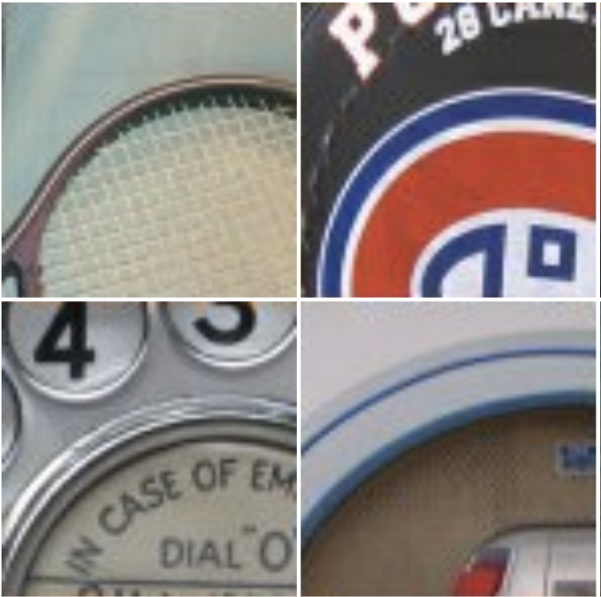

*论证 2：数据集示例——强烈触发该神经元的 ImageNet 图像。*

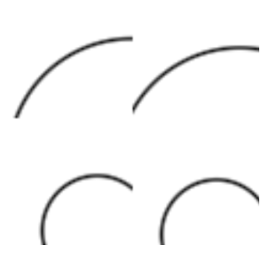

*论证 3：合成示例——按不同方向、曲率合成的曲线。*

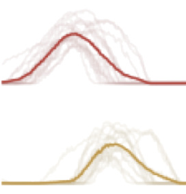

*论证 4：联合调谐——旋转输入后激活的此消彼长。*

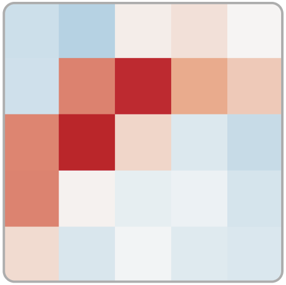

*论证 5：特征实现——从电路权重中读出的检测算法（5×5 权重）。*

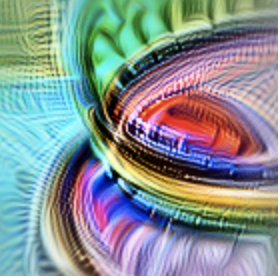

*论证 6：特征使用——下游"客户"特征（圆形等）以预期方式使用曲线检测器。*

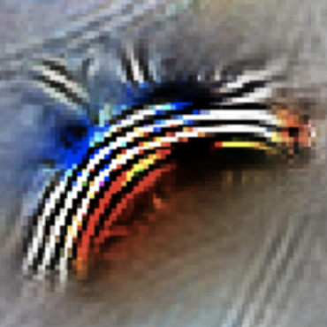

*论证 7：手写电路——"无尘室"式手工重实现的曲线检测。*

针对这其中的方法（也可以说是对"神经元确实有意义"这一主张的证据），作者提出了一个边界：即上述所有的论证，并未完全排除某种罕见的情况——曲线检测器因另一种刺激而触发。也就是说，误解的风险自始至终都没有被排除掉，只是这些证据让我们能够增加"神经元有意义"这一信念的置信度。

#### 例 2：高低频检测器 High-Low Frequency Detectors

作者在这里提出了另一个例子。不同于曲线检测器那样符合人们的直觉（所谓"直觉"的意思是：人们想当然地认为，如果神经网络拥有类似人一样的脑区，那么它理论上应该有"曲线检测器"这个功能），这个例子则比较抽象一些。

作者在早期视觉（early vision）中发现了它。这里所谓 early vision 的含义是在一个深层视觉网络中的浅层区域，不特指某一层。它的作用是在感受野的一侧寻找低频模式，在另一侧寻找高频模式。与曲线检测器一样，高低频检测器也以特征家族的形式存在，在不同方向上寻找相同的东西。

首先我们再来确定一下什么是"感受野"。CNN 的工作过程可以近似地理解为一种压缩，或者一种投影：它通过卷积核将原始图片中的一个矩阵区域压缩为一个标量，并递归式地对压缩后的特征图执行这一操作。

对于感受野的严格定义：在 CNN 中，特征图上的一个像素点，其值是由输入图像上某个区域的像素经过多次卷积计算得到的，这个输入图像上的区域就是该特征点的感受野。

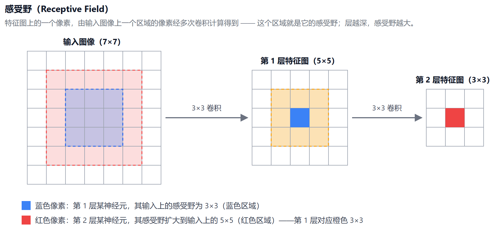

*图：感受野示意——特征图上的一个像素对应输入图像上的一个区域，层越深感受野越大（博主自绘）。*

也就是深层网络中特征图的一个标量，对应着原始图片上的一片区域。

理解了感受野以后，我们再看这个高低频检测器。它在一侧寻找低频模式、一侧寻找高频模式，具象来看可以想象成一个灯塔：它检测一个区域内的"高亮"情况，而探照灯以外的区域则是阴影。与灯塔不同的是，检测器的高亮区域对于家族中的一个成员而言是固定不变的，也就是一个匹配模板，在高匹配度的情况下会高激活。而文章中所谓的"高频模式"和"低频模式"，博主的理解是像素在空间中的变化率：例如有些区域的相邻像素颜色相同，那么就是低频；而有些色块相邻像素的颜色复杂丰富，则是高频。

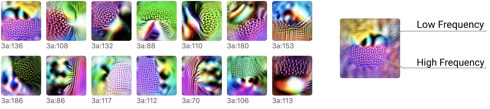

*图 3（原文插图）：高低频检测器：左侧为多个检测器单元，右侧标注了低频（Low Frequency）与高频（High Frequency）区域。*

#### 例 3：姿势不变的狗头检测器 Pose-Invariant Dog Head Detector

在这个例子中，作者抛出了第一个高维检测器。前两个检测器都是低层的特征检测器，它们都出现在 InceptionV1 的早期层当中。

首先，作者阐明：对于这个检测器，我们几乎无法理解其简单的几何形状，也无法理解其可视化的特征，它不存在如同曲线检测器那样很明显的曲线弧度。

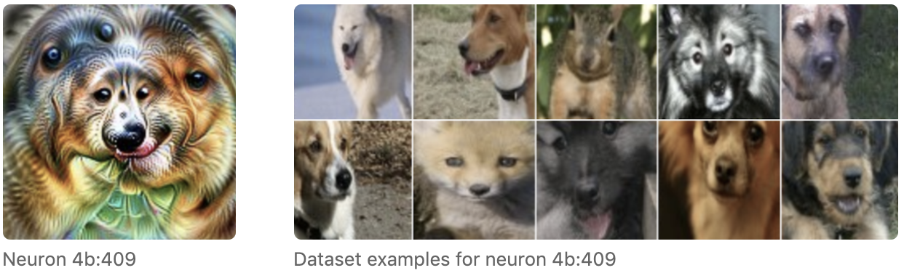

*图 4（原文插图）：左：神经元 4b:409 的特征可视化；右：神经元 4b:409 的数据集示例。*

作者在这个模块中未对狗头检测器做过多的描述，详细的内容将会在下文中具体说明。

#### 例 4：多语义神经元 Polysemantic Neurons

作者在这个模块中提出了一个发现，即神经网络存在"多语义神经元"，这种神经元会对多种不相关的输入作出响应。例如在 InceptionV1 模型中，有一个神经元可以同时响应猫脸、汽车正面和猫腿。而且值得注意的是，它之所以会响应，不是因为这些物品拥有某种共同之处——它们没有某种微妙的共享特征。在作者的实验中，他们发现某个神经元响应的是：猫的眼睛和胡须、毛茸茸的腿，以及闪亮的汽车正面。

*图 5（原文插图）：4e:55 是一个多语义神经元，对猫脸、汽车正面和猫腿做出响应。*

对于这样的神经元，我们可以使用"电路推演"来研究它们，有关电路的概念将在下文解释。

所以这种神经元为何存在？首先我们给这种特质命名为"叠加态"（superposition）：一种可能的原因是分布式存储——为了把更多的特征塞进有限的可用神经元中。

### 主张 2：电路 Circuits

什么是电路？其实更准确的描述可以叫做计算通路。在我们的深度网络系统中，神经元都由上一层神经元线性组合后加上激活函数来形成。从某种抽象的视角上来说，我们可以将它理解为一种拓扑图，而节点与节点之间的连接情况则是研究拓扑图中必不可少的一部分。所以从这个角度出发，作者认为研究神经元与神经元之间的连接关系以及联合作用是有必要的。这种 circuits 是网络的子图，它由一组紧密相连的特征以及它们之间的权重组成。

作者强调其发现了优美而丰富的结构，这些结构常常具有对称性。通过这一视角，我们可以理解神经网络权重的意义。

#### 电路 1：曲线检测器 Circuit 1：Curve Detectors

我们继续对曲线检测器做分析。在第一个主张中，我们已经提及过什么是曲线检测器。这一节中，作者提出了更优美的观点并给出了证据：曲线检测器主要由更早、更简单的曲线检测器和直线检测器实现；这些曲线检测器在下一层被用来创建三维几何检测器与更复杂的图像检测器；而且还存在一个通往其他特征的较小的连接。

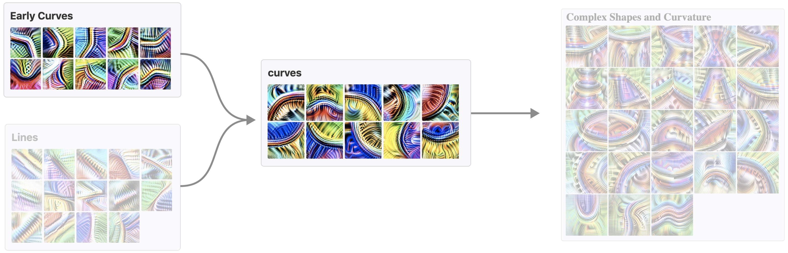

*图 6（原文插图）：曲线检测器电路的概览：早期曲线（Early Curves）与直线（Lines）汇合为曲线（Curves），进而产生复杂形状与曲率（Complex Shapes and Curvature）。*

在当前文章中，作者主要聚焦于早期曲线检测器与完整曲线检测器之间的相互作用。以下是现象原文：

> 让我们更进一步，看看单个早期曲线检测器如何连接到同一方向上一个更复杂的曲线检测器。
>
> 在这种情况下，我们的模型实现的是一个 5×5 卷积，因此连接这两个神经元的权重是一组 5×5 的权重，可正可负。
>
> **脚注 5**：本文讨论的许多神经元（包括曲线检测器）位于 InceptionV1 的分支中，这些分支的结构是：先通过一个 1×1 卷积把通道数缩减到一个小瓶颈，再接一个 3×3 或 5×5 卷积。我们在本文中呈现的权重，是 1×1 与较大卷积的权重相乘后的版本。我们认为，把它看作一个单一的低秩权重矩阵通常是有用的，但严格来说，这忽略了一个 ReLU 非线性。
>
> 正权重意味着：如果较早的神经元在那个位置触发，它会激发较晚的神经元；反之，负权重则意味着它会抑制它。
>
> 我们看到的，是以曲线检测器形状排列的强正权重。我们可以这样理解：沿曲线的每一个点，我们的曲线检测器都在用更早的曲线检测器寻找一个"切线曲线"（tangent curve）。
>
> 对于相似方向上每一对早期与完整的曲线检测器，这都是成立的：在曲线的每个点，它都检测相似方向的曲线；类似地，相反方向的曲线在曲线的每个点都是抑制性的。
>
> 曲线检测器被相似方向（similar orientations）的早期检测器所激发……而被相反方向（opposing orientations）的早期检测器所抑制。
>
> 值得在此反思的是：我们正在看神经网络的权重，而它们是有意义的。
>
> 你越是贴近观察，结构就越是丰富。例如，如果你观察一个与完整曲线检测器方向相似但不完全相同（similar, but not exactly the same orientation）的早期曲线检测器，你常常可以看到它在更对齐的一侧有更强的正权重。
>
> 还值得注意权重如何随曲线检测器的方向旋转。问题的对称性反映为权重的对称性。我们把表现出这种现象的电路称为"等变电路"（equivariant circuit），并将在后面的文章中深入讨论。

首先，明确作者的实验环境是使用一个 5×5 的卷积尺度对特征图进行卷积操作，因此我们可以视为连接处理前后特征图的是一组 5×5 的权重。对于这些权重，它们的数值有的是正数，有的是负数。你可以把这个正负数值视为一种逻辑门控，系统会学习到一种判别方法，滤波上一层的筛选结果。直觉上可以想象为一个匹配模板，在特征图上匹配对应的曲率——如果曲率符合系统要求，那么理论上会激活比较高的值。

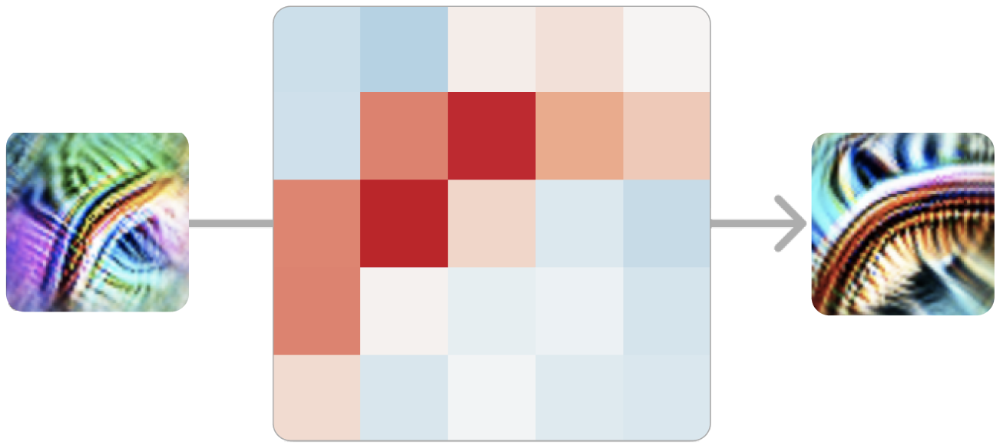

*图 7（原文插图）：同一方向上早期曲线检测器与后期曲线检测器之间的原始权重——一条被小的负权重或零权重包围的正权重曲线。*

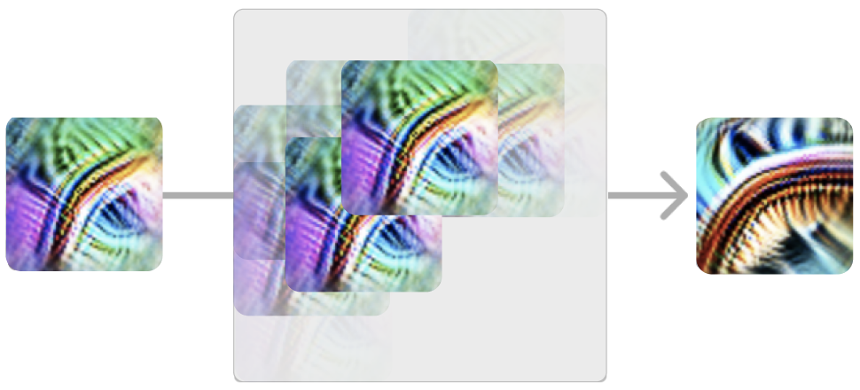

*图 8（原文插图）：这可以解释为，在曲线的每个点都在寻找"切线曲线"。*

这张图就很直观：这个 5×5 的核，强激活值恰好对应着一段曲率。对于一个通道而言，卷积核在上一层特征图上遍历，寻找该通道特异识别的曲率，并将结果压缩保存为下一份特征图。我们可以宽泛地认为，在 CNN 环境中每个通道才是一个神经元，每个通道的卷积核权重是一种模式匹配模板，负责不同形状的匹配状态，并将这些匹配状态压缩保存为一个新的特征图供后续的检测器使用。对于单个通道的工作性质而言，我们可以认为模板匹配类似于寻找一个"切线曲线"，也就是一小段完整曲线中的弧度。比如完整要匹配的曲线是一个抛物线，那么这个模板可能仅仅匹配该抛物线在 [-1,1] 这一小段上的曲率状态，看看哪些地方满足这些小段曲率的性质；而 n 个通道，也就是 n 个神经元，描述不同的小段的曲率，最终"积分"为完整的曲线检测器。

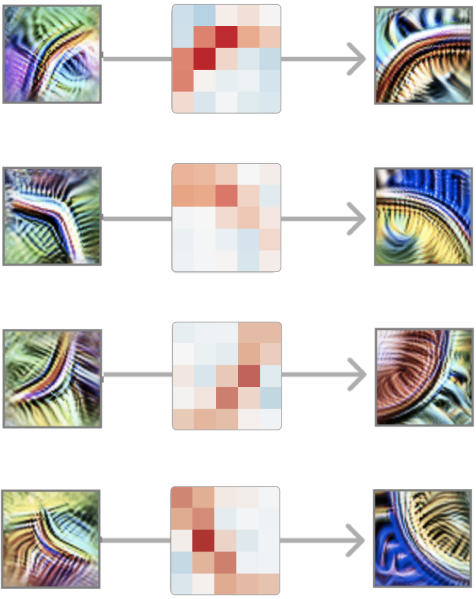

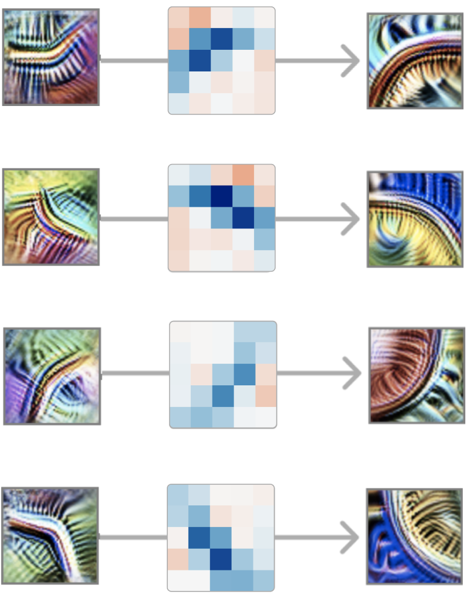

*图（原文插图）：曲线检测器被相似方向的早期检测器所激发（上），被相反方向的早期检测器所抑制（下）。*

除了这个发现以外，作者还发现了一个有趣的现象：如果你去观测一个和完整曲线检测器功能相似但不完全相同（如圆形检测器和椭圆检测器）的早期曲线检测器，你一般能够看到它在更符合原始图片的那一部分拥有更强的正权重。

#### 电路 2：定向狗头检测 Oriented Dog Head Detection

刚刚我们讨论的曲线检测器电路是一个比较低级的底层电路，它的过程只覆盖了上下两层。在这个例子中，作者将讨论一个跨越四层的高层高级电路。

这里作者首先申明的一点是：ImageNet 的工作主要是区分不同的动物。在这个例子中，它需要区分一百种不同的狗，所以它会发展出大量专门用于识别狗的相关特征的神经元。

作者在有关于这个电路的实验中发现了一个有趣的现象，以下是原文：

> 在这个"狗识别"系统中，有一个电路在我们看来特别有趣：一组处理朝左的狗头和朝右的狗头的神经元。在跨越三层的结构里，网络维持着两条镜像通路，分别检测朝左和朝右的类似单元。在每一步，这些通路都试图相互抑制，锐化对比。最后，它创造出对两条通路都做出响应的恒等神经元。
>
> 我们把这种模式称为"跨情形取并"（unioning over cases）。网络分别检测两种情形（左和右），然后对它们取并，以创造恒等的"多面"（multifaceted）单元。注意，因为两条通路相互抑制，这个电路实际上具有某种类 XOR（异或）的性质。

这里作者发现的现象大致可以理解为：有一组神经元，它们分别负责检测狗头向左或者狗头向右的两种状态，在每一步都是此消彼长的相互抑制、增加对比的状态，最终它们会合为同一个响应神经元，形成某种异或性质——也就是两条通路激活一条，则判断确实为狗头。

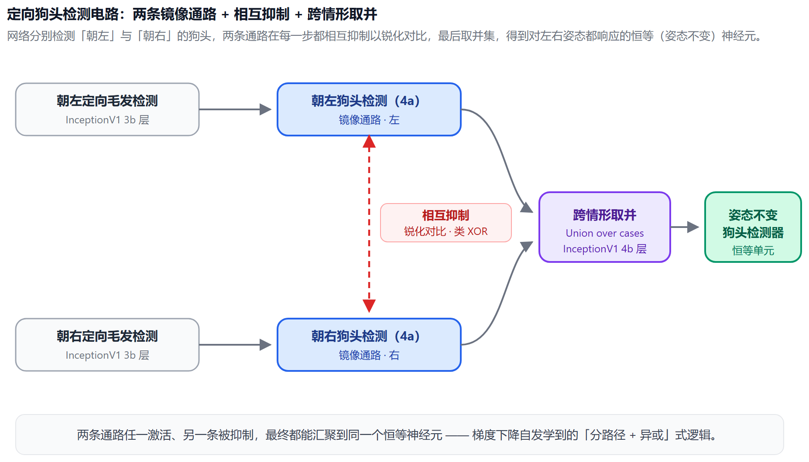

*图：定向狗头检测电路——网络维持两条镜像通路分别检测朝左、朝右的狗头，两通路相互抑制（类 XOR），最终取并形成恒等单元（博主自绘）。*

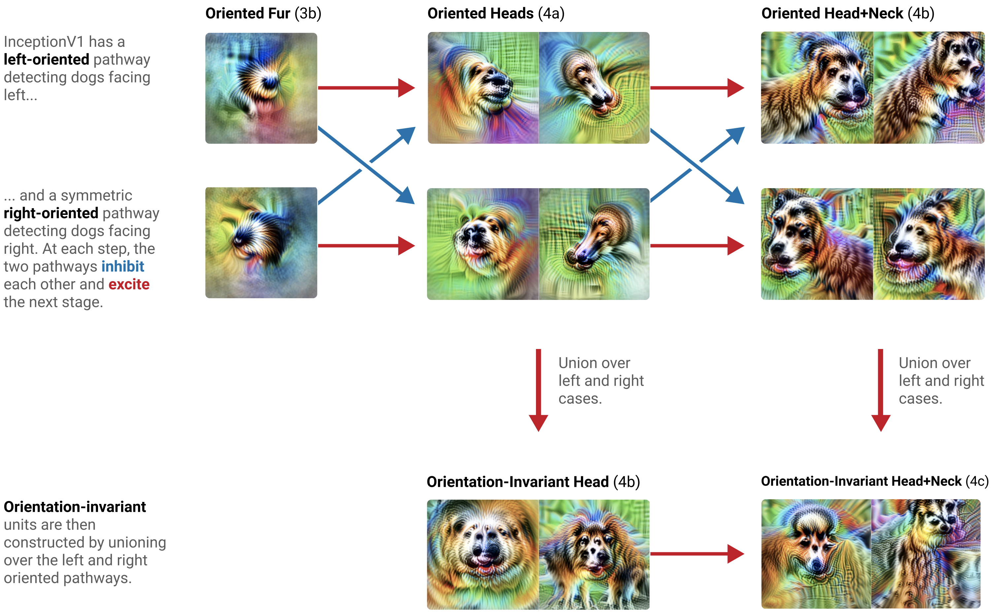

*图（原文插图）：定向狗头检测电路——网络维持两条镜像通路分别检测朝左、朝右的狗头，最终取并形成恒等单元。*

在这个例子中，作者最惊讶的是梯度下降算法竟然可以自发地实现这样的分路径异或逻辑算法。但博主认为这类算法的解释性不是特别高，因为这样的区分方式可能并不最优，也许是一种偶然现象。想象一个人是如何识别一只狗的——我们并不会去走一个左右异或的判断，而是去分辨其体态、五官分布等显著特征来确定。当然，在脑科学还没有完全解释人脑计算过程的阶段，这些都仅仅是哲学思考。

原文中还展示了这个电路的两个细节：

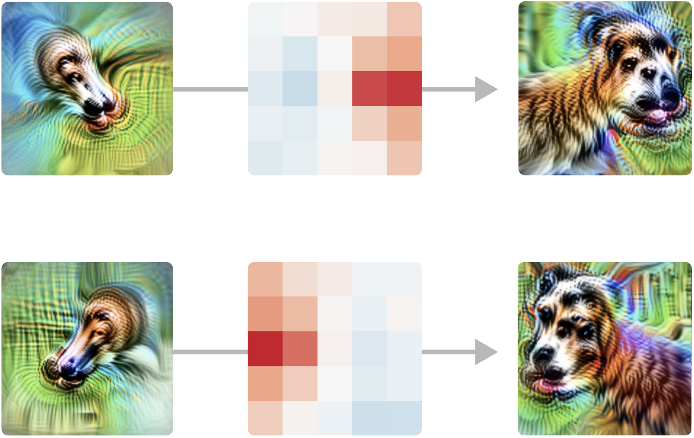

*图（原文插图）：带"头颈"的单元——头部只在正确的一侧被检测到。*

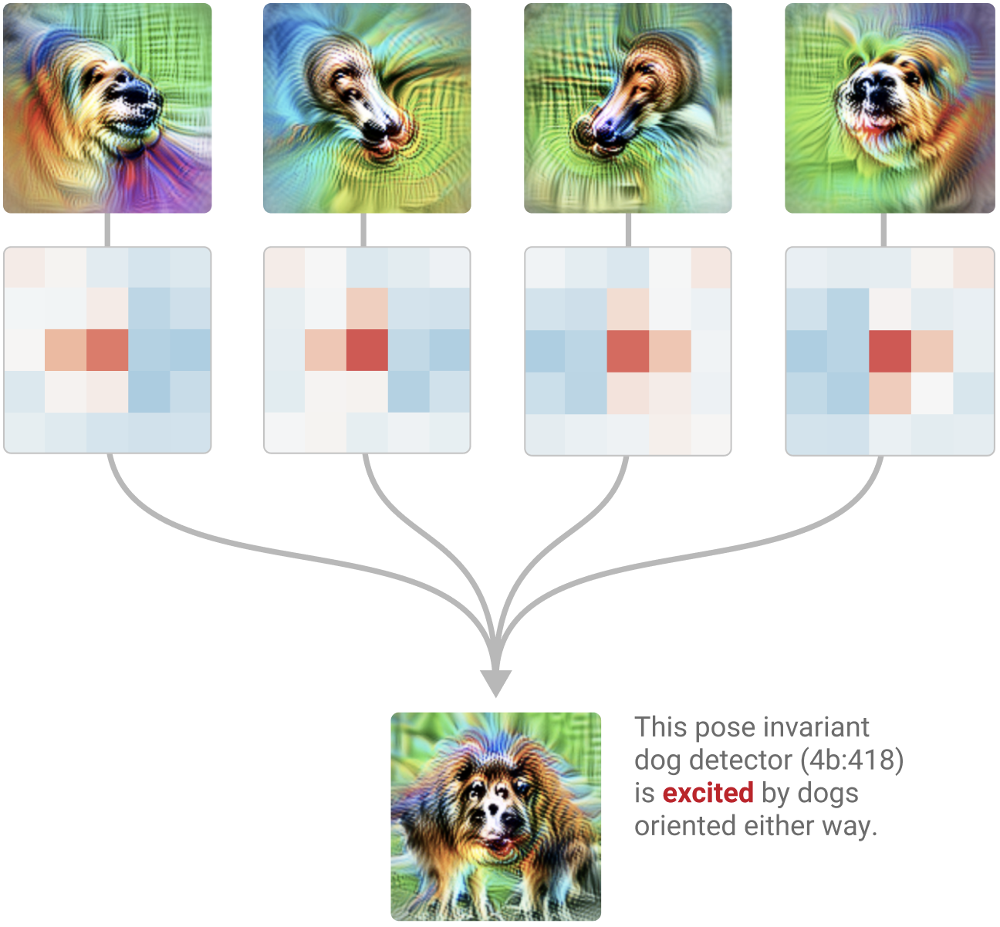

*图（原文插图）：取并步骤的细节——激发区域从中心向不同方向延伸，使鼻子汇聚到同一点。*

#### 电路 3：叠加态中的汽车 Cars in Superposition

在我们一直用来举例的 InceptionV1 网络中，中后期层 mixed4c 里有一个用来检测汽车的神经元。它利用前几层的特征，在卷积窗口的底部寻找车轮，在顶部寻找车窗。

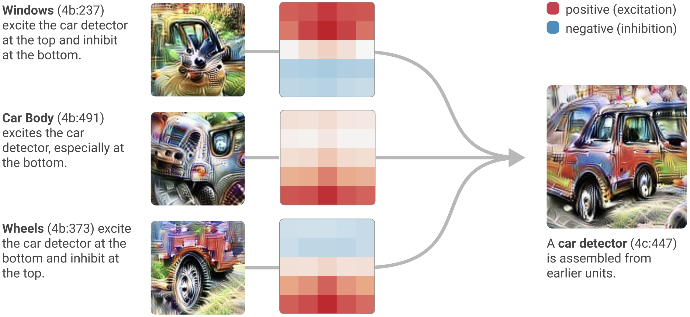

*图（原文插图）：汽车检测电路——底部找车轮，顶部找车窗。*

初看这个结论十分优雅，但随后模型做了一件让人惊讶的事情：它没有在下一层创造另一个纯粹的汽车检测器，而是把它的汽车特征散布到若干似乎主要处理别的事情——尤其是检测狗——的神经元上。

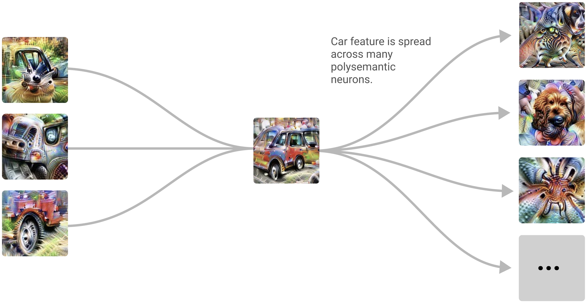

*图（原文插图）：叠加态——汽车特征被散布到多个似乎主要在检测狗的神经元上。*

作者提到：

> 这个电路表明，多语义神经元在某种意义上是有意为之。也就是说，你可以想象一个世界，在那里，检测汽车和检测狗的过程出于某种原因被深深交织在模型中，因此多语义神经元难以避免。但我们在这里看到的，是模型先有一个"纯粹神经元"，然后把它与其他特征混合起来。

我们把这种现象称为叠加态（superposition）。

这其实很像人脑的状态。在神经科学的一些研究中，大家也发现记忆功能不一定只存在于海马体，还有一些其他的功能也参与了记忆的存储工作，也就是系统是一个分布式处理过程。从数学的角度上来看，其计算过程也许是高维的，只是在二维的权重中才显得如此混乱。当然这只是博主的一个小猜想；也有一种可能是梯度算法的局限性，导致内部空间表征的塑造不够理想。从这个角度出发，我们更应该详细地研究内部特征形成的机理，以至于使得我们能够通过干预神经元的生长发展，诱导它长出一些干净的、简洁的计算电路。我认为这有助于降低模型的参数量和训练时长。

言归正传，作者给出了他对叠加态出现的猜想——它为什么要这样做？

> 我们相信，叠加态让模型能够使用更少的神经元，把它们节省下来用于更重要的任务。只要汽车和狗不同时出现，模型就可以在更后的层中准确地检索出狗的特征，从而在不专门占用一个神经元的情况下存储这个特征。从根本上说，这是高维空间几何的一个性质：高维空间只允许 n 个正交向量，却允许指数多个近似正交的向量。

也就是说，从代数角度出发，同维度下，空间只允许少量的相互垂直的方向，却允许许多有公共分量的相似向量。将这些少量的核心方向用于关键判断的性价比更高。

#### 电路母题 Circuit Motifs

这是作者提出的一个研究推荐方向。首先，什么是母题（Motifs）？在生物学中，电路母题指的是诸如转录网络或生物神经网络这类复杂图中反复出现的模式。母题之所以重要，是因为理解一个母题，能让研究者对其出现的所有图都获得杠杆作用。

比如我们反复看到同样的抽象模式：等变性、跨情形取并、叠加态——诸如这样出现在系统中的性质，研究它们可能对我们理解神经网络很重要。

### 主张 3：普适性 Universality

在多个网络与任务中，作者都观察到了上述的一些性质。也就是说，类似的特征与电路会跨模型、跨任务形成。

比如一个被广泛接受的事实：在自然图像上训练的第一层视觉模型会学习形成 Gabor 滤波器，这种滤波器是专门用来识别边缘、纹理、方向、频率的，也就是一些图像统计特征。

特征形成的普适性（又称趋同学习 convergent learning）在早些时候就已经被提出了。已经有工作表明，不同的神经网络可以发展出高度相关的神经元，并在隐藏层学习相似的表征。不过我们今天能够提供的证据都只是轶事性的，科学家们依旧没有在特征与电路的比较研究上投入得足够多。但尽管如此，一些非常底层的特征（如直线、曲线）似乎确实在各种各样的架构中都会形成（包括 AlexNet、InceptionV1、InceptionV3 和 ResNet）。

**曲线检测器在不同模型中的特征可视化对比：**

**AlexNet（Krizhevsky 等）**

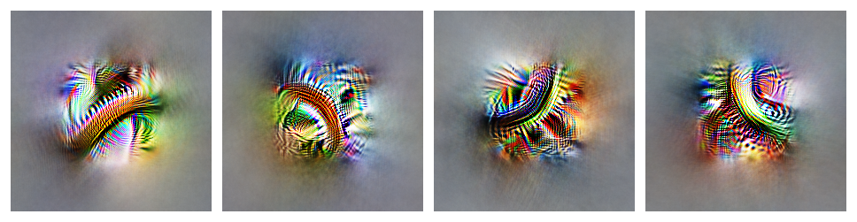

**InceptionV1 / GoogLeNet（Szegedy 等）**

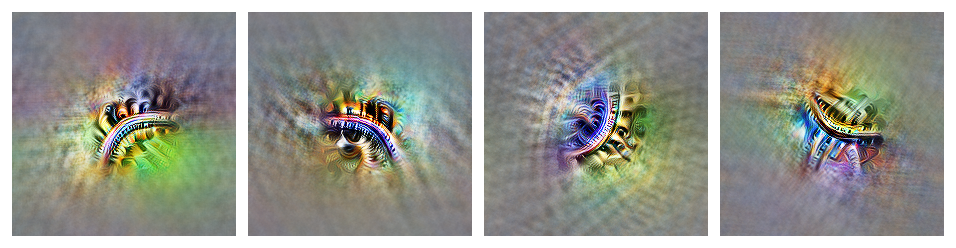

**VGG19（Simonyan 等）**

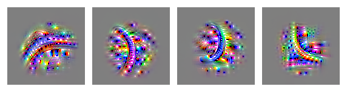

**ResNetV2-50（He 等）**

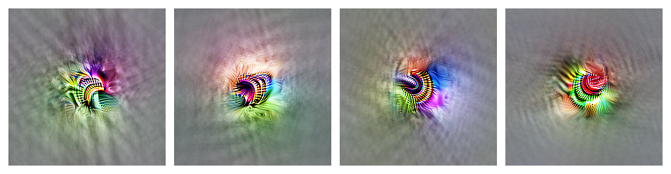

*图（原文插图）：曲线检测器在 AlexNet、InceptionV1（GoogLeNet）、VGG19、ResNetV2-50 各模型中的特征可视化对比。*

**高低频检测器在不同模型中的特征可视化对比：**

**AlexNet（Krizhevsky 等）**

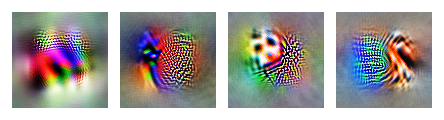

**InceptionV1 / GoogLeNet（Szegedy 等）**

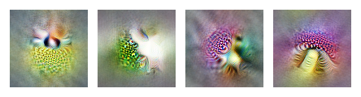

**VGG19（Simonyan 等）**

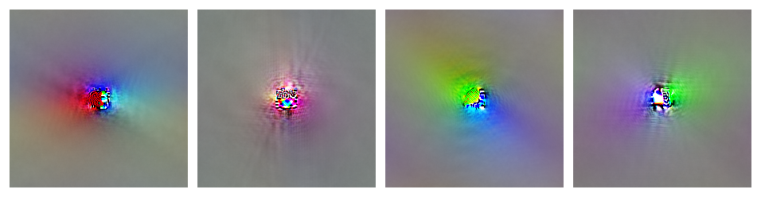

**ResNetV2-50（He 等）**

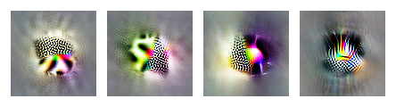

*图（原文插图）：高低频检测器在 AlexNet、InceptionV1（GoogLeNet）、VGG19、ResNetV2-50 各模型中的特征可视化对比。*

这些发现支持着普适性假说，但是要理解某些低层视觉特征的表面是否真的具有普适性，还需要进一步研究。

并且在生物神经科学中，已经有部分工作表明，如曲线检测器这样的特征提取器确实也存在于生物神经网络中。

普适性是否存在决定着我们后续的研究方向。以生物学为例，如果每一种生物、每一种细胞都有自己独特的性质，那我们仅研究少数重要的细胞种类即可；但如果神经网络的普适性为真，那么我们也许可以作出一种类似于元素周期表一样的"视觉特征周期表"。这都需要充分地去研究，可解释性研究的道路还有很长。

### 结语

众所周知，显微镜是一件重要的科学仪器，以至于其符号几乎成为了科学的象征。不过显微镜在真正流行起来之前大概沉寂了五十年。如今的可解释性学术社区中依然有一些焦虑：可解释性的研究不被认真对待，被认为太定性。可解释性研究是人工智能的细胞学，只是研究方法过于困难且缺乏工具，我相信这项研究最终会对社会产生重大的影响。
